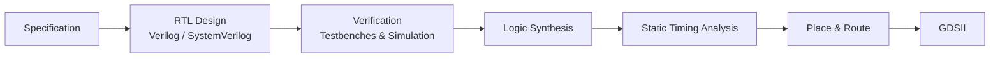

 

---

## About

ECE student working where **digital hardware meets the physical world** — writing RTL that has to close timing, and firmware that turns sensor readings into connected systems.

I care about the full path: a clean specification, synthesizable RTL, a testbench that actually proves it, and a device that survives contact with reality.

## What I Work On

| Domain | Details |
| --- | --- |
| **VLSI / Digital Design** | RTL in Verilog & SystemVerilog, FSM design, self-checking testbenches, logic synthesis, static timing analysis |
| **Embedded Systems** | ESP32 & ARM Cortex-M firmware in C/C++, peripheral drivers, UART / I2C / SPI, low-power design |
| **IoT** | Wi-Fi connectivity, MQTT telemetry, sensor integration, edge-to-cloud data pipelines |

## VLSI Design Flow

## Toolbox

  

 

 

## Featured Projects

### CalcMaster Pro
A responsive scientific calculator with dark/light themes, calculation history, and full keyboard support.

`JavaScript` · [Live Demo](https://akashmunnaprasad.github.io/calculator) · [Source](https://github.com/AkashMunnaPrasad/calculator)

### Personal Portfolio
My portfolio site, built with TypeScript and deployed on Vercel.

`TypeScript` · [Live Site](https://akash-munna-prasad-portfolio.vercel.app/) · [Source](https://github.com/AkashMunnaPrasad/portfolio)

## Currently Building

- **RTL building blocks** — parameterized UART, FIFO, and ALU implementations with self-checking testbenches, simulated and synthesized in Vivado
- **ESP32 IoT sensor node** — Wi-Fi device publishing sensor telemetry over MQTT to a live dashboard
- Deepening **static timing analysis** and the synthesis-to-layout flow

## GitHub Stats

## Connect

  

RTL → Silicon → Sensors · Always building.

